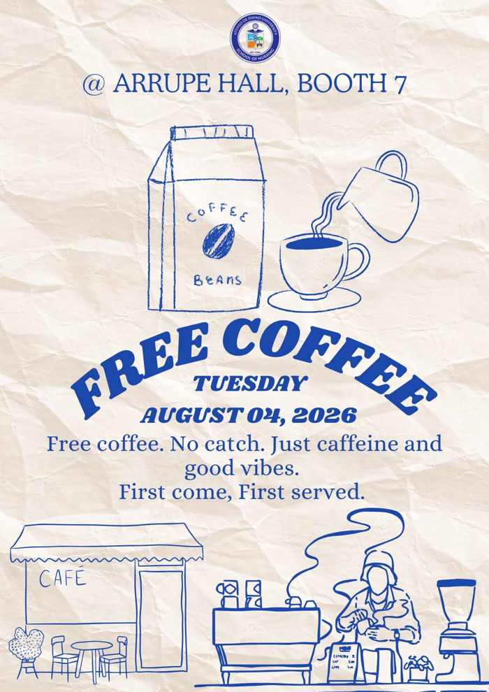

<picture>
  <source media="(prefers-color-scheme: dark)" srcset="../assets/header-01-dark.svg" />
  
</picture>

An event poster for a free coffee booth at Arrupe Hall. Built around visual hierarchy, a limited palette and hand drawn illustration.

### Files

- [`free-coffee-poster.png`](free-coffee-poster.png) &nbsp; Poster

[← Back to portfolio](../README.md)
