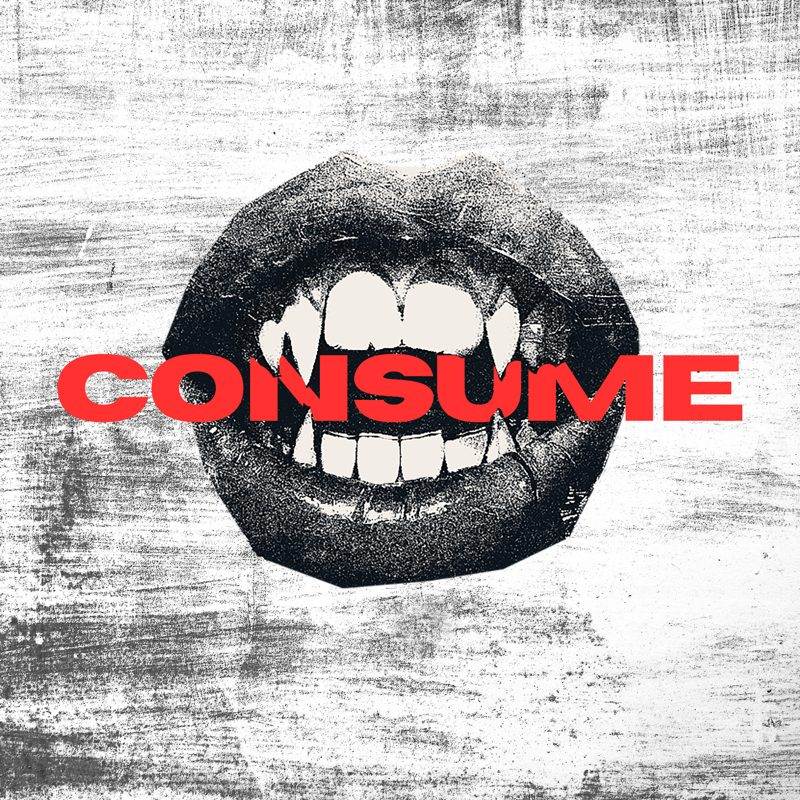
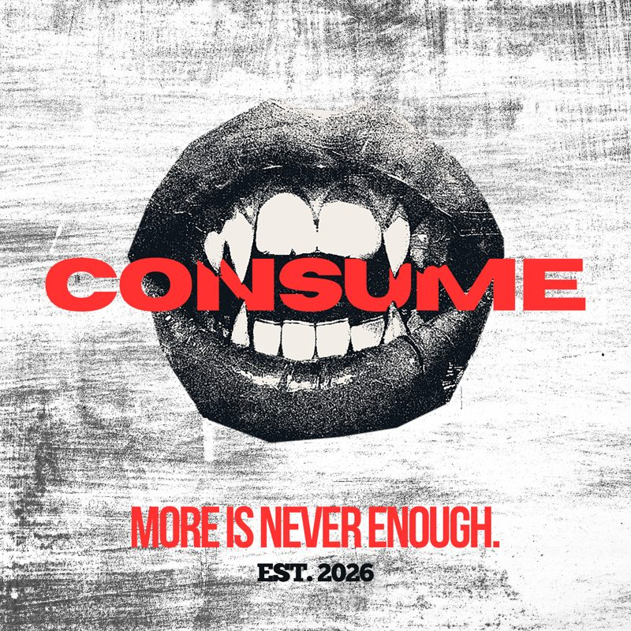
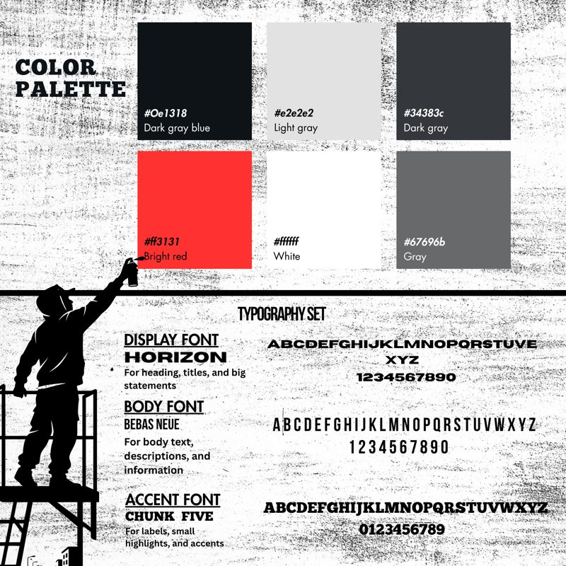
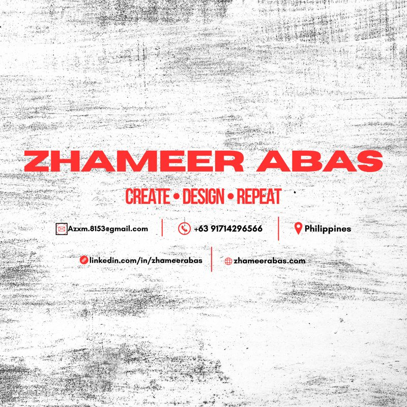

<picture>
  <source media="(prefers-color-scheme: dark)" srcset="../assets/header-02-dark.svg" />
  
</picture>

  
  
  
  

A personal brand kit: logo, tagline, color palette, type system and contact card. The red, black and grey used across this repo come from this kit.

### Files

- [`brand-kit.zip`](brand-kit.zip) &nbsp; Full brand kit (4 PNGs)

[← Back to portfolio](../README.md)
