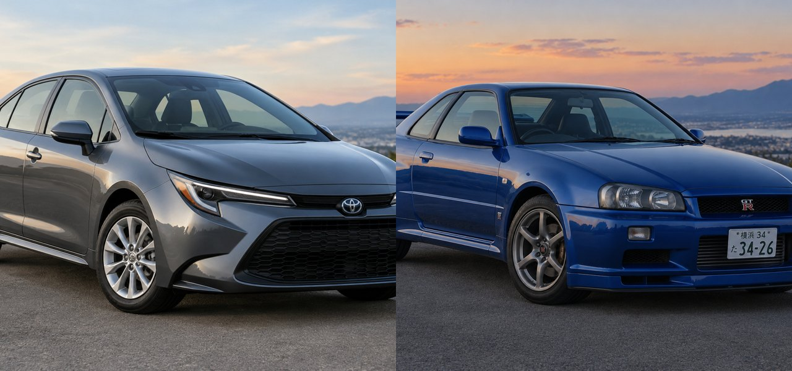

<picture>
  <source media="(prefers-color-scheme: dark)" srcset="../assets/header-05-dark.svg" />
  
</picture>

BEFORE &nbsp;·&nbsp; "Generate a modern car" &nbsp;&nbsp;&nbsp;&nbsp;&nbsp;&nbsp; AFTER &nbsp;·&nbsp; Improved prompt

Testing how much a better prompt changes an AI image. I started ChatGPT with a vague prompt, then rewrote it with specific details: a late 1990s Japanese sports coupe in deep metallic blue, two doors, low and wide stance, rectangular headlights, multi spoke wheels and a subtle rear spoiler. Then I compared both outputs on clarity, detail, accuracy and usefulness.

### Files

- [`ai-tools-activity.pdf`](ai-tools-activity.pdf) &nbsp; Prompts, outputs and analysis

[← Back to portfolio](../README.md)
