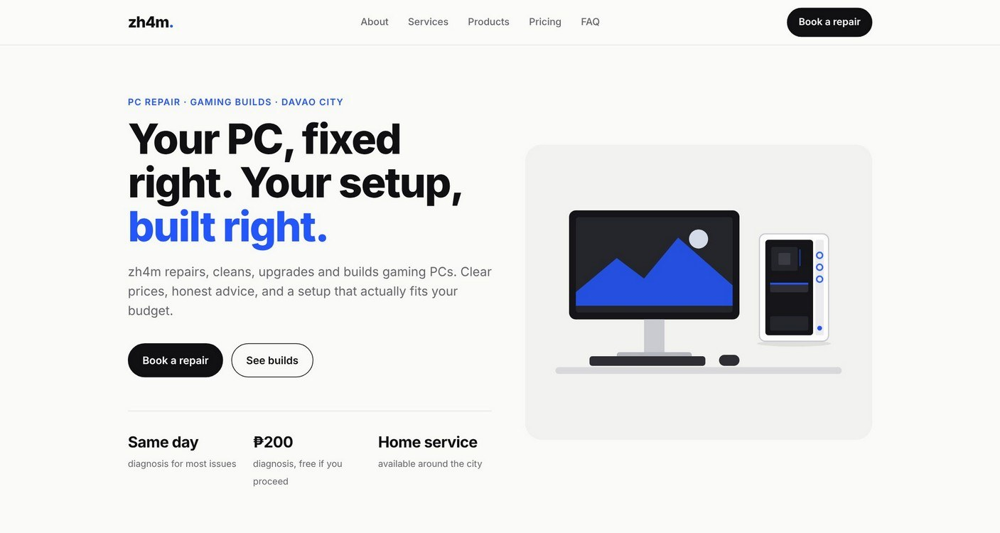

<picture>
  <source media="(prefers-color-scheme: dark)" srcset="../assets/header-06-dark.svg" />
  
</picture>

A one page website for zh4m, a PC repair and custom gaming build business idea in Davao City. It covers the about, services, build packages, parts with prices, rates, FAQ and contact. I had the AI ask me questions about the concept, style and sections first, then build from my answers.

[**Live site →**](https://claude.ai/artifact/Gu851QT34LLmS4WjiyDfbL)

### Files

- [`one-page-website.pdf`](one-page-website.pdf) &nbsp; Documentation: prompts, screenshots and reflection

[← Back to portfolio](../README.md)
