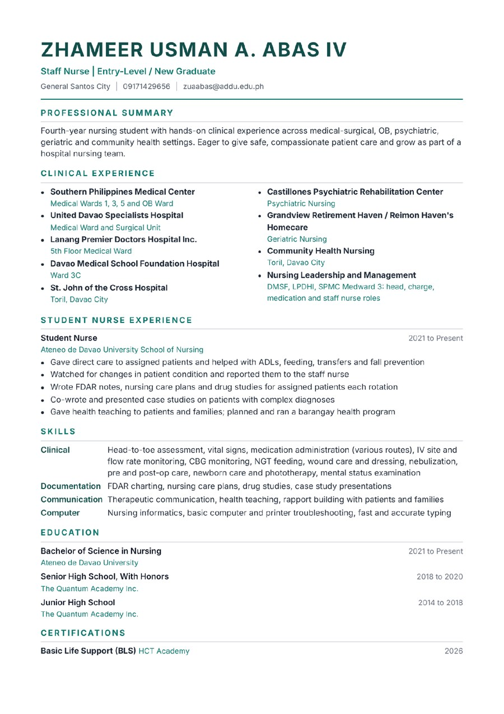

<picture>
  <source media="(prefers-color-scheme: dark)" srcset="../assets/header-07-dark.svg" />
  
</picture>

One prompt, two AI tools. I asked Claude and ChatGPT for a one page staff nurse resume, compared them on structure, clarity, formatting and overall quality, then combined the best parts into a final version.

### Files

- [`resume-generating.pdf`](resume-generating.pdf) &nbsp; Prompt, outputs, comparison table, reflection and final resume

[← Back to portfolio](../README.md)
