# Activity 1: Presentation Design Principles

An event poster for **Free Coffee Tuesday**, a free coffee booth at Arrupe Hall. The goal was to apply basic design principles so people can get the what, when and where in a few seconds.

## ✦ What I learned

- **Key skills:** I learned how visual hierarchy guides the eye. The biggest text carries the main message, then the date and place, then the small details. A limited palette of blue on cream kept everything looking like one piece.
- **Challenge:** Fitting all the event details without crowding the illustration. I cut the text down to short lines and grouped related info together so the drawing still had room.
- **Next time:** I can use the same hierarchy for health teaching posters and ward announcements, where people only glance for a few seconds.

## ✦ Files

- [`free-coffee-poster.png`](free-coffee-poster.png) &nbsp; Poster

 

[← Back to portfolio](../README.md)
