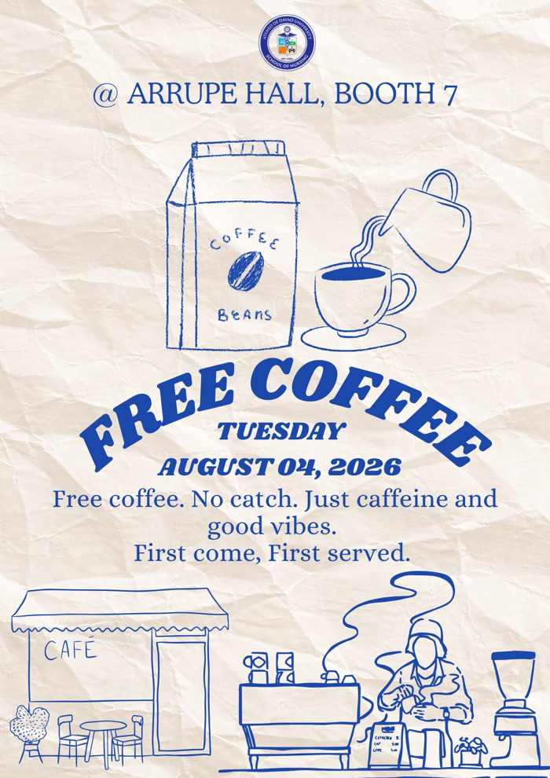

# Activity 1: Presentation Design Principles

## ❯ About the activity

For this activity I made a poster for a free coffee booth at Arrupe Hall, Booth 7. We had to apply the design principles we discussed in class so people could tell what the event is about in just a few seconds.

## ❯ What have I learned?

I learned that not everything on a poster should be the same size. The title should stand out the most, then the date and place, then the small details. I also kept the colors to just blue and cream so it wouldn't look messy. The hardest part was coming up with a design that felt unique but still minimal. I tried a few layouts before going with the hand drawn coffee look, then kept removing things until only what mattered was left. I think I can use this when making health teaching posters for the ward, since people there usually just glance at them.

## ❯ Files

- [`free-coffee-poster.png`](free-coffee-poster.png) &nbsp; Poster

 

[`cd ..`](../README.md) &nbsp; back to portfolio
