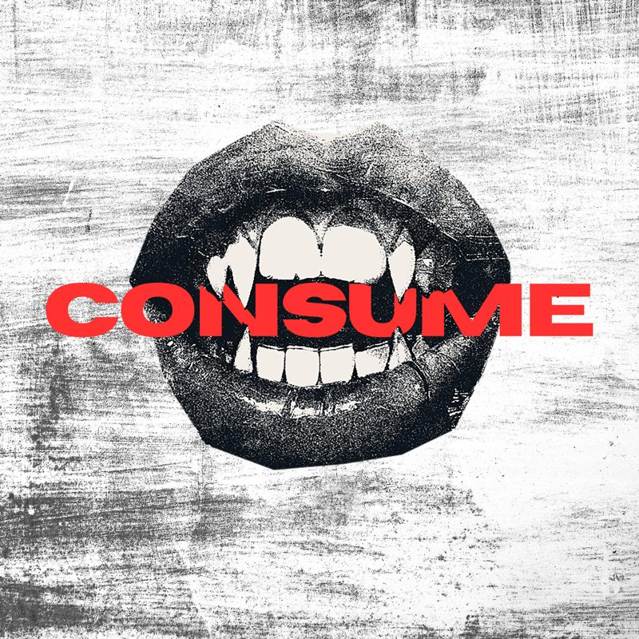
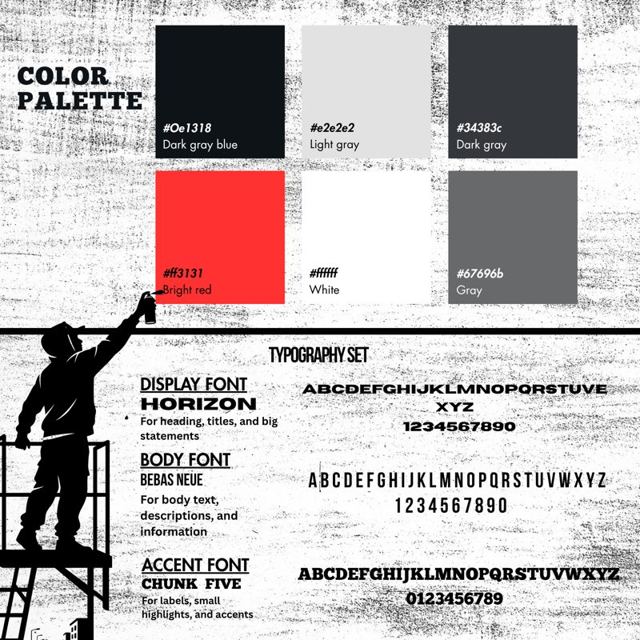
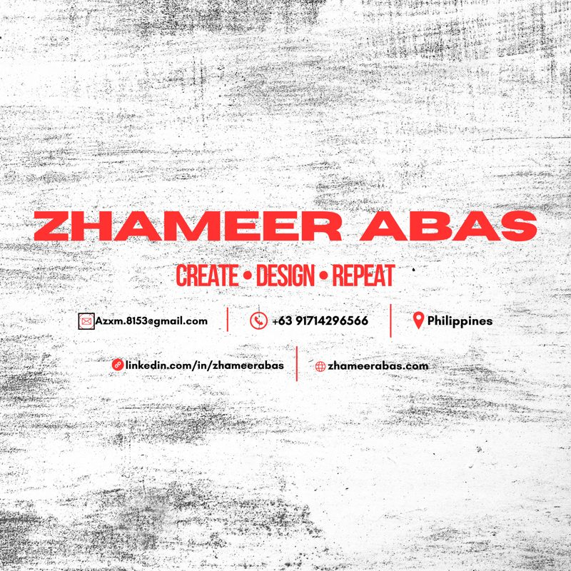

# Activity 2: Personal Branding

  
  
  
  

## ❯ About the activity

This activity was about making my own personal brand. I made a logo, a tagline, a color palette, a set of fonts and a contact card, all with a gritty graffiti look built around the word "CONSUME".

## ❯ What have I learned?

Before this I thought branding was just the logo, but it's really about keeping everything consistent. I picked one bright red for accents and gave each font its own job: Horizon for titles, Bebas Neue for body text and Chunk Five for small accents. My biggest challenge was making the brand look unique without making it cluttered. The graffiti textures looked too busy at first, so I kept the colors to black, white and grey and only used red where I really wanted attention. I'm into streetwear, so I'd like to build on this kit for my own clothing brand someday.

## ❯ Files

- [`brand-kit.zip`](brand-kit.zip) &nbsp; Brand kit (4 PNG pages)

 

[`cd ..`](../README.md) &nbsp; back to portfolio
