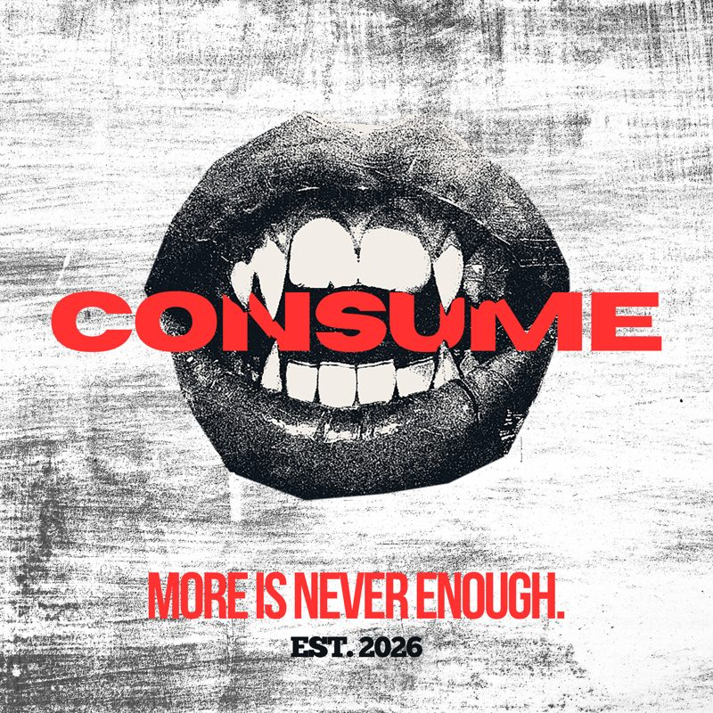

# Activity 2: Personal Branding

  
  
  
  

A personal brand kit with a logo, tagline, color palette, typography set and contact card. It has a gritty, graffiti inspired look built around the word **CONSUME**.

## ✦ What I learned

- **Key skills:** A brand is a system, not just a logo. I picked a palette with one accent red (#ff3131) and three fonts with clear jobs: Horizon for display, Bebas Neue for body and Chunk Five for accents.
- **Challenge:** The textures and graffiti made the designs feel busy at first. I fixed it by keeping everything black, white and grey and saving red for the main elements only.
- **Next time:** I can grow this kit into a full streetwear brand, with the same rules applied to clothing tags, social posts and packaging.

## ✦ Files

- [`brand-kit.zip`](brand-kit.zip) &nbsp; Brand kit (4 PNG pages)

 

[← Back to portfolio](../README.md)
