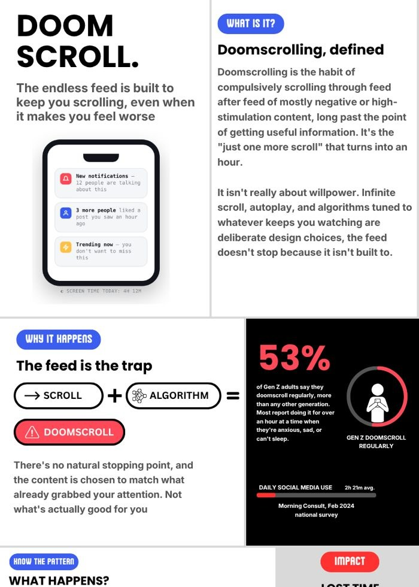

# Activity 3: Infographic and Documentation

A social media infographic on **doomscrolling**: what it is, why the feed keeps you hooked, the warning signs and how to break the habit. It comes with a written report backed by data from Morning Consult, the American Academy of Sleep Medicine and WHO Europe.

## ✦ What I learned

- **Key skills:** I learned how to turn research into something people can read while scrolling. That meant short sections, bold numbers and icons, all in one vertical flow.
- **Challenge:** I found more statistics than one graphic could hold. I kept only the strongest numbers, like 53% of Gen Z adults doomscrolling, and left the rest for the report.
- **Next time:** This is basically health teaching in visual form. I can use the same approach for patient handouts on topics like sleep hygiene or screen time.

## ✦ Files

- [`doom-scroll-infographic.png`](doom-scroll-infographic.png) &nbsp; Infographic
- [`project-documentation.pdf`](project-documentation.pdf) &nbsp; Research report

 

[← Back to portfolio](../README.md)
