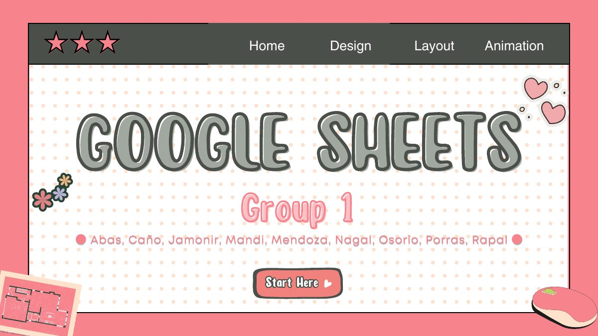

# Activity 4: Group Presentation

## ❯ About the activity

Our group made a 25 slide interactive presentation using Google Sheets instead of PowerPoint. It has a clickable menu for Home, Design, Layout and Animation, and it ends with a game we called *Budget or Burado?*

Abas · Caño · Jamonir · Mandi · Mendoza · Nagal · Osorio · Porras · Rapal

## ❯ What have I learned?

I didn't know Google Sheets could be used like this. We linked the sheets together so they work like buttons, and we used the cells as a grid to lay out each slide. The challenge for me was the design, since we wanted it to look unique and fun but still minimal and easy to follow. We settled on one simple style and a fixed menu bar, then used that same template on every slide so all 25 looked consistent. Next time I'd use this to make a review game for my classmates, since everyone already has Sheets.

## ❯ Files

- [`google-sheets-presentation.pdf`](google-sheets-presentation.pdf) &nbsp; Presentation export

 

[`cd ..`](../README.md) &nbsp; back to portfolio
