# Activity 5: AI Tools

BEFORE &nbsp;·&nbsp; "Generate a modern car" &nbsp;&nbsp;&nbsp;&nbsp;&nbsp;&nbsp; AFTER &nbsp;·&nbsp; Improved prompt

## ❯ About the activity

In this activity I tested how much the prompt affects what ChatGPT makes. I first asked it to "generate a modern car", then rewrote the prompt with a lot more detail, asking for a late 1990s Japanese sports coupe in metallic blue. After that I compared the two images.

## ❯ What have I learned?

The main thing I learned is that the AI only knows what you tell it. My first prompt gave me a plain grey sedan that looked like any car on the road. Once I listed the era, color, body style, wheels and spoiler, I got pretty much the car I had in mind. I also noticed the AI added things I never asked for, like a real brand logo and a license plate, so I need to check the output closely. From now on I'll be specific with my prompts from the start.

## ❯ Files

- [`ai-tools-activity.pdf`](ai-tools-activity.pdf) &nbsp; Prompts, outputs and analysis

 

[`cd ..`](../README.md) &nbsp; back to portfolio
