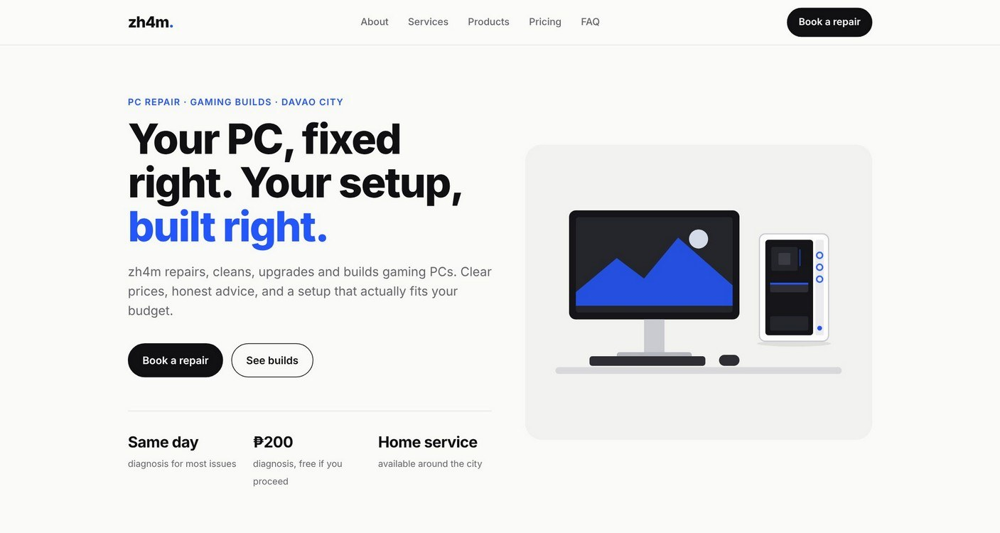

# Activity 6: One Page Website

## ❯ About the activity

I made a one page website for zh4m, a PC repair and custom gaming PC business idea here in Davao City. The site shows the services, build packages, parts with prices, rates, FAQs and how to contact the business.

[**Live site →**](https://claude.ai/artifact/Gu851QT34LLmS4WjiyDfbL)

## ❯ What have I learned?

What worked best was letting the AI ask me questions first instead of giving it one long prompt. That way I could decide the concept, style and sections one at a time, and the site ended up close to what I pictured. My plan was to use Replit, but the free plan only had a few AI credits a day and one published app, so I switched to Claude. Even with AI doing a lot, I still had to pick the name, choose the look and check that the prices made sense. If I turn this into a real business, I'd add real photos and a booking form.

## ❯ Files

- [`one-page-website.pdf`](one-page-website.pdf) &nbsp; Prompts, screenshots and reflection

 

[`cd ..`](../README.md) &nbsp; back to portfolio
