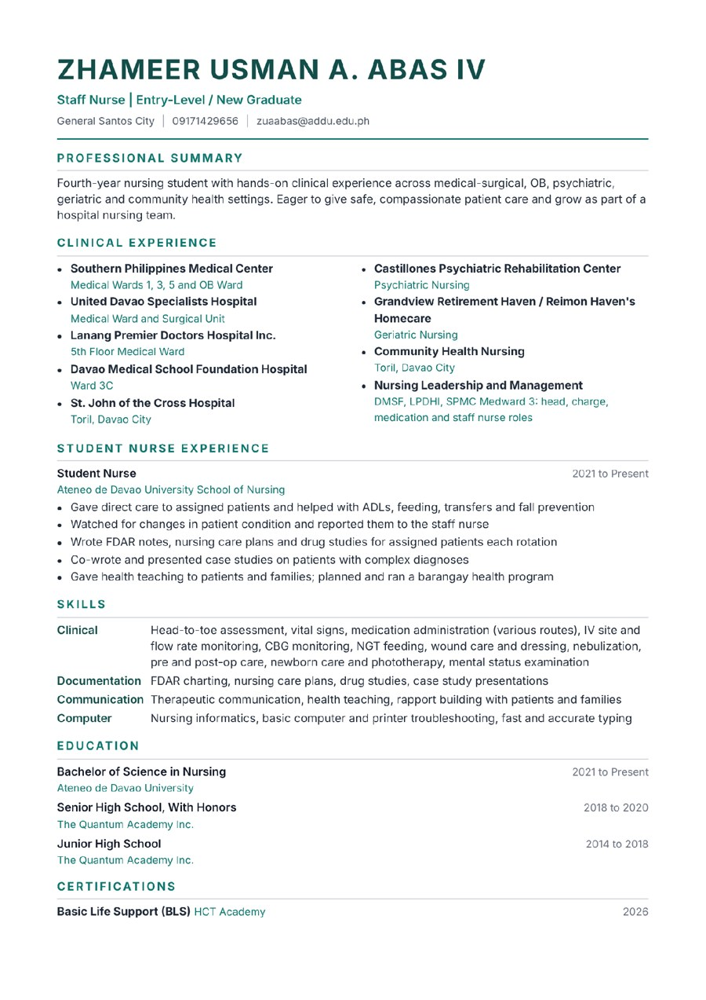

# Activity 7: Resume Generating

## ❯ About the activity

For this activity I gave the same prompt to Claude and ChatGPT and asked both to write a one page resume for an entry level staff nurse job. Then I compared the two based on structure, clarity, formatting and overall quality, and made my own final version.

## ❯ What have I learned?

I learned that the result depends a lot on how clear my instructions are. Both tools got the same info, but the layouts came out really different. Neither one was perfect. Claude's was easier to read, while ChatGPT's sounded more formal but left half the page blank. So I combined them, using Claude's layout, spelling out the full hospital names and grouping my skills by category. I'll keep updating this resume as I finish my rotations and use it when I apply for staff nurse jobs.

## ❯ Files

- [`resume-generating.pdf`](resume-generating.pdf) &nbsp; Prompt, both outputs, comparison, reflection and final resume

 

[`cd ..`](../README.md) &nbsp; back to portfolio
