<picture>
  <source media="(prefers-color-scheme: dark)" srcset="assets/banner-dark.svg" />
  
</picture>

  

  

<h3 align="center">Zhameer Usman A. Abas IV</h3>

  Hi, I'm <b>zh4m</b>, a 4th year BS Nursing student (BSN 4D) at Ateneo de Davao University. 
  This repo holds my work for GE 4120, a 21st Century IT Skills elective.

  Gaming &nbsp;·&nbsp; PC repair and custom builds &nbsp;·&nbsp; Streetwear and graphic design &nbsp;·&nbsp; Nursing informatics

 

## Skills and tools

- **Design:** visual hierarchy, color and type choices, layout for posters, infographics and slides
- **Branding:** building a consistent identity with a logo, tagline, palette and fonts
- **Research to visuals:** turning survey data into an infographic with cited sources
- **Interactive presentations:** linked navigation inside Google Sheets
- **Prompting AI:** writing specific prompts and comparing outputs across tools
- **Web and docs:** making a one page website with AI, and organizing work on GitHub with Markdown

Canva &nbsp;·&nbsp; Google Sheets &nbsp;·&nbsp; ChatGPT &nbsp;·&nbsp; Claude &nbsp;·&nbsp; GitHub &nbsp;·&nbsp; Markdown

 

## Activities

  <a href="Activity-1-Design-Principles"><picture><source media="(prefers-color-scheme: dark)" srcset="assets/card-01-dark.svg" /></picture></a>
  <a href="Activity-2-Personal-Branding"><picture><source media="(prefers-color-scheme: dark)" srcset="assets/card-02-dark.svg" /></picture></a>

  <a href="Activity-3-Infographic"><picture><source media="(prefers-color-scheme: dark)" srcset="assets/card-03-dark.svg" /></picture></a>
  <a href="Activity-4-Group-Presentation"><picture><source media="(prefers-color-scheme: dark)" srcset="assets/card-04-dark.svg" /></picture></a>

  <a href="Activity-5-AI-Tools"><picture><source media="(prefers-color-scheme: dark)" srcset="assets/card-05-dark.svg" /></picture></a>
  <a href="Activity-6-One-Page-Website"><picture><source media="(prefers-color-scheme: dark)" srcset="assets/card-06-dark.svg" /></picture></a>

  <a href="Activity-7-Resume-Generating"><picture><source media="(prefers-color-scheme: dark)" srcset="assets/card-07-dark.svg" /></picture></a>

 

| # | Activity | Files |
|:-:|:--|:--|
| 1 | [Design Principles](Activity-1-Design-Principles) | [PNG](Activity-1-Design-Principles/free-coffee-poster.png) |
| 2 | [Personal Branding](Activity-2-Personal-Branding) | [ZIP](Activity-2-Personal-Branding/brand-kit.zip) |
| 3 | [Infographic](Activity-3-Infographic) | [PNG](Activity-3-Infographic/doom-scroll-infographic.png) · [PDF](Activity-3-Infographic/project-documentation.pdf) |
| 4 | [Group Presentation](Activity-4-Group-Presentation) | [PDF](Activity-4-Group-Presentation/google-sheets-presentation.pdf) |
| 5 | [AI Tools](Activity-5-AI-Tools) | [PDF](Activity-5-AI-Tools/ai-tools-activity.pdf) |
| 6 | [One Page Website](Activity-6-One-Page-Website) | [PDF](Activity-6-One-Page-Website/one-page-website.pdf) |
| 7 | [Resume Generating](Activity-7-Resume-Generating) | [PDF](Activity-7-Resume-Generating/resume-generating.pdf) |

 

<a href="https://github.com/zh4m">@zh4m</a>

