  

  
  
  
  

 

> This repository is my portfolio for **GE 4120 Elective**. It collects the laboratory activities and projects I made for the course, from poster design and personal branding to an infographic and a group presentation.

 

<!-- 01 -->
<h2 id="01"></h2>

<table>
  <tr>
    <td width="45%" align="center"></td>
    <td width="55%" valign="middle">
      An event poster for a free coffee booth at Arrupe Hall.
        
      <b>Focus</b> 
      Visual hierarchy &nbsp;·&nbsp; Limited palette &nbsp;·&nbsp; Illustration &nbsp;·&nbsp; Clear information
        
      <a href="Activity%201"><b>View files →</b></a>
    </td>
  </tr>
</table>

 

<!-- 02 -->
<h2 id="02"></h2>

<table>
  <tr>
    <td width="25%"></td>
    <td width="25%"></td>
    <td width="25%"></td>
    <td width="25%"></td>
  </tr>
  <tr>
    <td align="center"><b>LOGO</b></td>
    <td align="center"><b>TAGLINE</b></td>
    <td align="center"><b>COLOR & TYPE</b></td>
    <td align="center"><b>CONTACT CARD</b></td>
  </tr>
</table>

<a href="Activity%202"><b>View files →</b></a>

 

<!-- 03 -->
<h2 id="03"></h2>

<table>
  <tr>
    <td width="55%" valign="middle">
      A social media infographic on doomscrolling: what it is, why the feed keeps you hooked, the warning signs, and practical ways to break the habit.
        
      Paired with a <b>Project Documentation</b> PDF showing the design process.
        
      <a href="Activity%203"><b>View files →</b></a>
    </td>
    <td width="45%" align="center"></td>
  </tr>
</table>

 

<!-- 04 -->
<h2 id="04"></h2>

  

  An interactive 25 slide presentation by Group 1, with clickable navigation across Home, Design, Layout and Animation.
   
  Abas · Caño · Jamonir · Mandi · Mendoza · Nagal · Osorio · Porras · Rapal
    
  <a href="Activity%204"><b>View files →</b></a>

 

---

  Thank you for visiting &nbsp;·&nbsp; <a href="https://github.com/zh4m">@zh4m</a>

