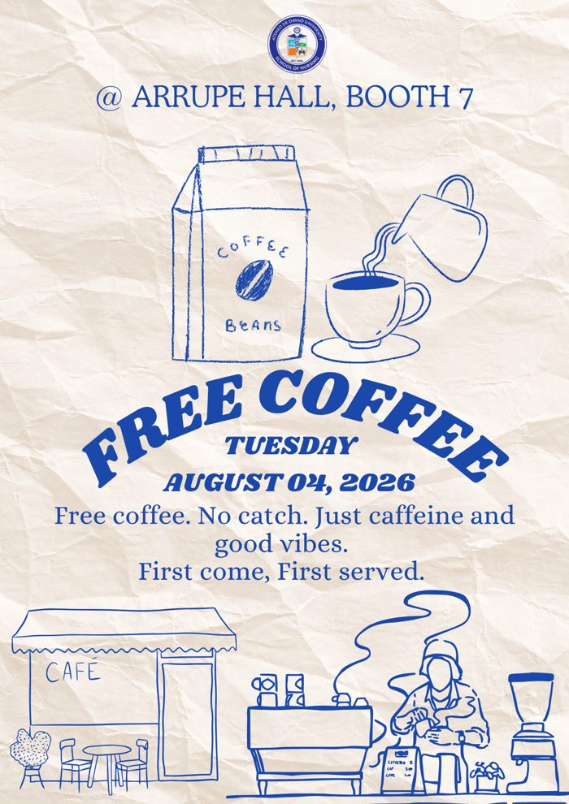
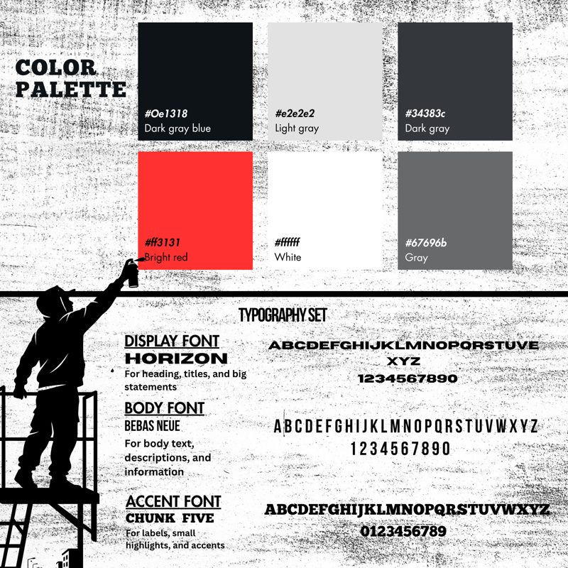
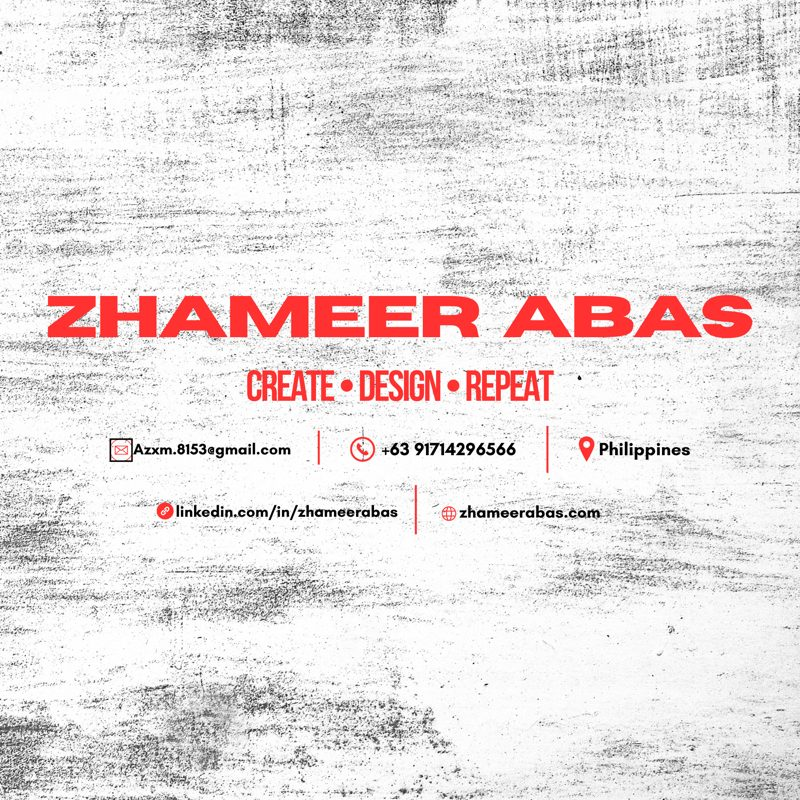
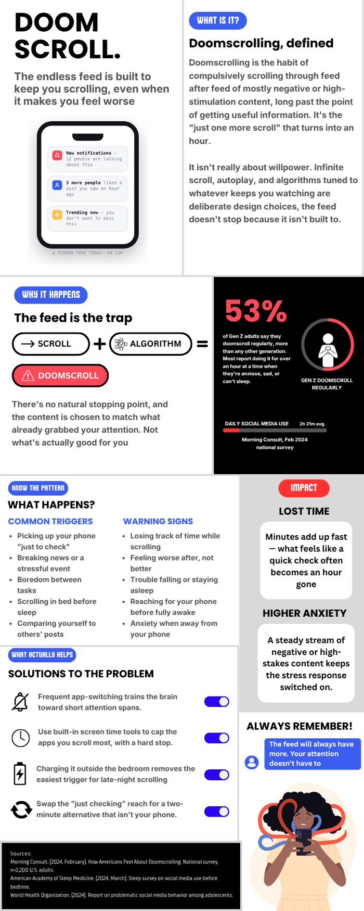
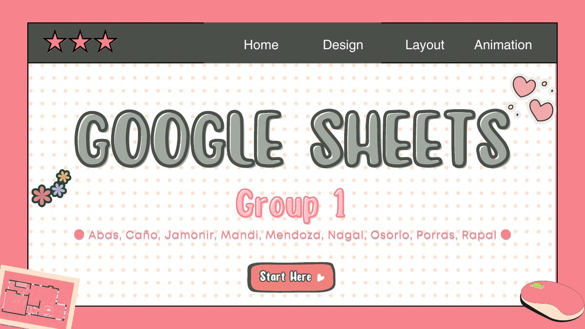

<!-- HEADER -->
<p align="center">
  
</p>

<p align="center">
  
</p>

<p align="center">
  
  
  
</p>

<br/>

<!-- ABOUT -->
## 👋 About Me

<table>
  <tr>
    <td width="60%" valign="top">
      Hi! I'm <b>Zhameer</b>, a nursing student exploring design and digital tools on the side.
      <br/><br/>
      This repository is my portfolio for <b>GE 4120 Elective</b>. It collects every laboratory activity and project from the course: a poster, a personal brand kit, an infographic with documentation, and a group presentation.
    </td>
    <td width="40%" valign="top">
      <b>📛 Name</b><br/>Zhameer Usman A. Abas IV<br/><br/>
      <b>🎓 Program</b><br/>BS Nursing, 4th Year<br/><br/>
      <b>🏫 School</b><br/>Ateneo de Davao University
    </td>
  </tr>
</table>

<br/>

<!-- OVERVIEW -->
## 🧭 Overview

<div align="center">

| | Activity | Topic | Format | |
|:---:|:---|:---|:---:|:---:|
|  | **Presentation Design Principles** | Free Coffee Tuesday poster | `PNG` | [View](Activity%201) |
|  | **Personal Branding** | Brand identity kit | `ZIP` | [View](Activity%202) |
|  | **Infographic & Documentation** | Doom Scroll | `PNG` `PDF` | [View](Activity%203) |
|  | **Group Presentation** | Google Sheets | `PDF` | [View](Activity%204) |

</div>

<br/>

<!-- ACTIVITY 1 -->
## 🎨 Activity 01 &nbsp;|&nbsp; Presentation Design Principles

<table>
  <tr>
    <td width="42%" align="center">
      
    </td>
    <td width="58%" valign="top">
      <h3>☕ Free Coffee Tuesday</h3>
      An event poster for a free coffee booth at Arrupe Hall.
      <br/><br/>
      <b>Principles applied</b>
      <ul>
        <li>Clear visual hierarchy with a bold headline</li>
        <li>Limited two color palette</li>
        <li>Hand drawn illustrations for a friendly feel</li>
        <li>Key details placed where the eye lands</li>
      </ul>
      <a href="Activity%201"></a>
    </td>
  </tr>
</table>

<br/>

<!-- ACTIVITY 2 -->
## 🪪 Activity 02 &nbsp;|&nbsp; Personal Branding

A complete brand identity kit: logo, tagline, color palette, typography system and a personal contact card.

<table>
  <tr>
    <td align="center" width="25%"><br/><sub><b>Logo</b></sub></td>
    <td align="center" width="25%"><br/><sub><b>Tagline</b></sub></td>
    <td align="center" width="25%"><br/><sub><b>Color & Type</b></sub></td>
    <td align="center" width="25%"><br/><sub><b>Contact Card</b></sub></td>
  </tr>
</table>

<p align="center">
  <a href="Activity%202"></a>
</p>

<br/>

<!-- ACTIVITY 3 -->
## 📊 Activity 03 &nbsp;|&nbsp; Infographic & Project Documentation

<table>
  <tr>
    <td width="58%" valign="top">
      <h3>📱 Doom Scroll.</h3>
      A social media infographic about doomscrolling and why the feed is built to keep you hooked.
      <br/><br/>
      <b>What it covers</b>
      <ul>
        <li>What doomscrolling is</li>
        <li>Why it happens</li>
        <li>Triggers and warning signs</li>
        <li>Impact on time and anxiety</li>
        <li>Practical ways to break the habit</li>
      </ul>
      Comes with a <b>Project Documentation</b> PDF showing the process behind the design.
      <br/><br/>
      <a href="Activity%203"></a>
    </td>
    <td width="42%" align="center">
      
    </td>
  </tr>
</table>

<br/>

<!-- ACTIVITY 4 -->
## 👥 Activity 04 &nbsp;|&nbsp; Group Presentation

<p align="center">
  
</p>

<div align="center">

**Google Sheets** · Group 1

An interactive 25 slide presentation with clickable navigation across Home, Design, Layout and Animation.

<sub>Abas · Caño · Jamonir · Mandi · Mendoza · Nagal · Osorio · Porras · Rapal</sub>

<br/><br/>

<a href="Activity%204"></a>

</div>

<br/>

<!-- STRUCTURE -->
## 📁 Repository Structure

```
GE-4120-Elective/
├── Activity 1/    Presentation Design Principles
├── Activity 2/    Personal Branding
├── Activity 3/    Infographic & Project Documentation
├── Activity 4/    Group Presentation (Google Sheets)
├── assets/        README preview images
└── README.md
```

<br/>

<!-- FOOTER -->
<div align="center">

**Thank you for checking out my repository!** 💙

<a href="https://github.com/zh4m"></a>

</div>

<p align="center">
  
</p>
