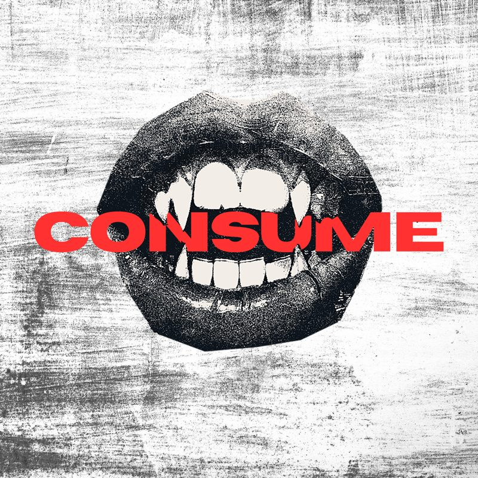
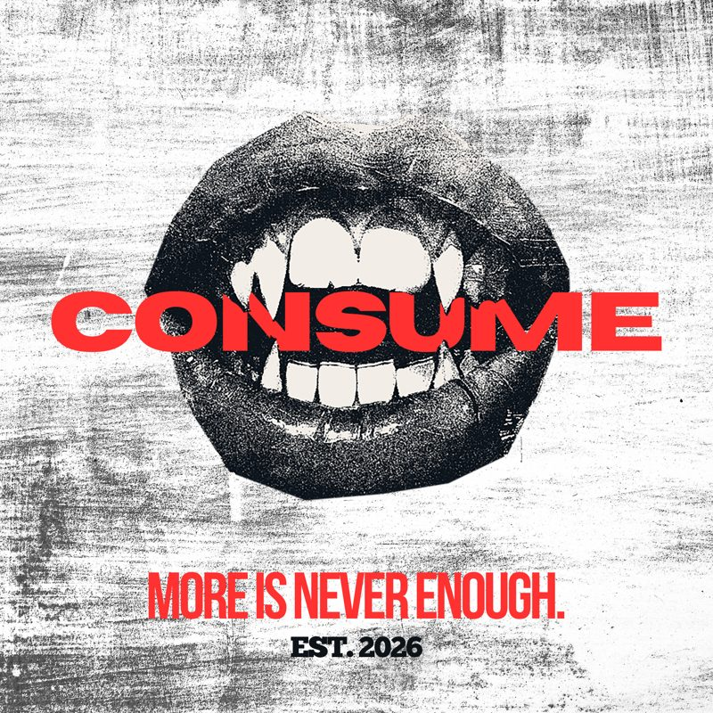
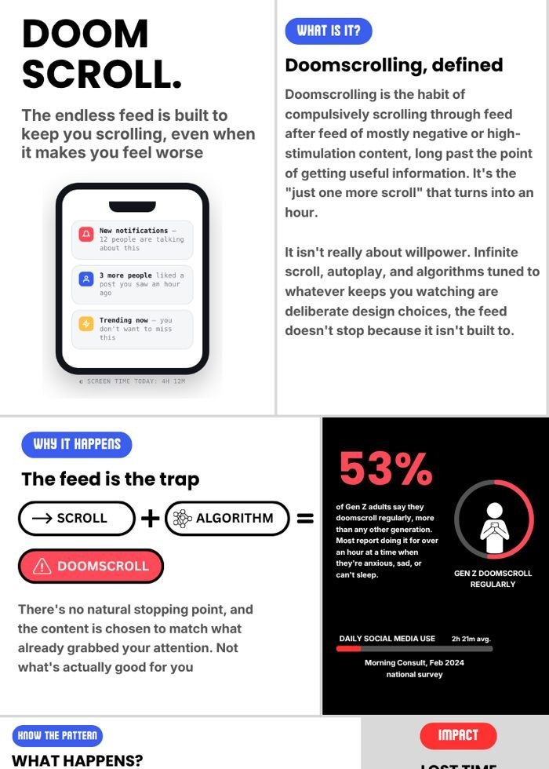

  

  
    <a href="#01">DESIGN PRINCIPLES</a> &nbsp;&nbsp;/&nbsp;&nbsp;
    <a href="#02">PERSONAL BRANDING</a> &nbsp;&nbsp;/&nbsp;&nbsp;
    <a href="#03">INFOGRAPHIC</a> &nbsp;&nbsp;/&nbsp;&nbsp;
    <a href="#04">GROUP PRESENTATION</a>
  

 

Lab activities and projects for **GE 4120**, a 21st Century IT Skills elective. Poster design, personal branding, an infographic and a group presentation, all in one place.

 

<a href="01-design-principles">
  <picture>
    <source media="(prefers-color-scheme: dark)" srcset="assets/header-01-dark.svg" />
    
  </picture>
</a>

  

An event poster for a free coffee booth at Arrupe Hall. Built around visual hierarchy, a limited palette and hand drawn illustration.

[**View file →**](01-design-principles/free-coffee-poster.png)

 

<a href="02-personal-branding">
  <picture>
    <source media="(prefers-color-scheme: dark)" srcset="assets/header-02-dark.svg" />
    
  </picture>
</a>

  
  
  
  

A personal brand kit: logo, tagline, color palette, type system and contact card. This page uses the same palette and display font.

[**Download kit →**](02-personal-branding/brand-kit.zip)

 

<a href="03-infographic">
  <picture>
    <source media="(prefers-color-scheme: dark)" srcset="assets/header-03-dark.svg" />
    
  </picture>
</a>

  

A social media infographic on doomscrolling: what it is, why the feed keeps you hooked, the warning signs and how to break the habit. Comes with project documentation of the design process.

[**Full infographic →**](03-infographic/doom-scroll-infographic.png) &nbsp;&nbsp; [**Documentation →**](03-infographic/project-documentation.pdf)

 

<a href="04-group-presentation">
  <picture>
    <source media="(prefers-color-scheme: dark)" srcset="assets/header-04-dark.svg" />
    
  </picture>
</a>

  

A 25 slide interactive presentation on Google Sheets by Group 1, with clickable navigation across Home, Design, Layout and Animation.

Abas · Caño · Jamonir · Mandi · Mendoza · Nagal · Osorio · Porras · Rapal

[**View slides →**](04-group-presentation/google-sheets-presentation.pdf)

 

  <a href="https://github.com/zh4m">@zh4m</a> &nbsp;·&nbsp; Ateneo de Davao University

