  

 

<table align="center">
  <tr>
    <td width="170" align="center" valign="middle">
      
    </td>
    <td valign="middle">
      <h3>Zhameer Usman A. Abas IV</h3>
      Hi, I'm <b>zh4m</b>. I'm a 4th year <b>BS Nursing</b> student (BSN 4D) at <b>Ateneo de Davao University</b>.
      This repo holds my work for GE 4120, a 21st Century IT Skills elective.
        
      <b>Interests</b> &nbsp; gaming · PC repair and custom builds · streetwear and graphic design · nursing informatics
    </td>
  </tr>
</table>

 

### Skills and tools I learned

  
  
  
  
  
  

- **Design:** visual hierarchy, color and type choices, layout for posters, infographics and slides
- **Branding:** building a consistent identity with a logo, tagline, palette and fonts
- **Research to visuals:** turning survey data into an infographic with cited sources
- **Interactive presentations:** linked navigation inside Google Sheets
- **Prompting AI:** writing specific prompts and comparing outputs across tools
- **Web and docs:** making a one page website with AI, and organizing work on GitHub with Markdown

 

### Activities

  
  

  
  

  
  

  

 

| | Activity | What I made | Files |
|:-:|:--|:--|:--|
| **1** | [Design Principles](Activity-1-Design-Principles) | Event poster for a free coffee booth | [PNG](Activity-1-Design-Principles/free-coffee-poster.png) |
| **2** | [Personal Branding](Activity-2-Personal-Branding) | Logo, tagline, palette, type and contact card | [ZIP](Activity-2-Personal-Branding/brand-kit.zip) |
| **3** | [Infographic](Activity-3-Infographic) | Doomscrolling infographic with a research report | [PNG](Activity-3-Infographic/doom-scroll-infographic.png) · [PDF](Activity-3-Infographic/project-documentation.pdf) |
| **4** | [Group Presentation](Activity-4-Group-Presentation) | 25 slide interactive deck on Google Sheets | [PDF](Activity-4-Group-Presentation/google-sheets-presentation.pdf) |
| **5** | [AI Tools](Activity-5-AI-Tools) | Vague vs detailed prompt for a ChatGPT car image | [PDF](Activity-5-AI-Tools/ai-tools-activity.pdf) |
| **6** | [One Page Website](Activity-6-One-Page-Website) | Site for zh4m, a PC repair and gaming build business | [PDF](Activity-6-One-Page-Website/one-page-website.pdf) |
| **7** | [Resume Generating](Activity-7-Resume-Generating) | Nursing resume made with Claude and ChatGPT, compared | [PDF](Activity-7-Resume-Generating/resume-generating.pdf) |

 

  <a href="https://github.com/zh4m">@zh4m</a> &nbsp;·&nbsp; BSN 4D &nbsp;·&nbsp; Ateneo de Davao University

