 

<table align="center"><tr><td align="center" width="900">
 

### Zhameer Usman A. Abas IV

I'm a 4th year **BS Nursing** student (BSN 4D) at **Ateneo de Davao University**. 
This repo holds my lab activities and projects for GE 4120, a 21st Century IT Skills elective.

`gaming` &nbsp; `pc-repair` &nbsp; `custom-builds` &nbsp; `graphic-design` &nbsp; `streetwear` &nbsp; `nursing-informatics`
  
</td></tr></table>

 

**Tools:** `canva` `google-sheets` `chatgpt` `claude` `github` `markdown`

 

  
  

  
  

  
  

  

 

| # | Activity | Files |
|:-:|:--|:--|
| 1 | [Design Principles](Activity-1-Design-Principles) | [PNG](Activity-1-Design-Principles/free-coffee-poster.png) |
| 2 | [Personal Branding](Activity-2-Personal-Branding) | [ZIP](Activity-2-Personal-Branding/brand-kit.zip) |
| 3 | [Infographic](Activity-3-Infographic) | [PNG](Activity-3-Infographic/doom-scroll-infographic.png) · [PDF](Activity-3-Infographic/project-documentation.pdf) |
| 4 | [Group Presentation](Activity-4-Group-Presentation) | [PDF](Activity-4-Group-Presentation/google-sheets-presentation.pdf) |
| 5 | [AI Tools](Activity-5-AI-Tools) | [PDF](Activity-5-AI-Tools/ai-tools-activity.pdf) |
| 6 | [One Page Website](Activity-6-One-Page-Website) | [PDF](Activity-6-One-Page-Website/one-page-website.pdf) |
| 7 | [Resume Generating](Activity-7-Resume-Generating) | [PDF](Activity-7-Resume-Generating/resume-generating.pdf) |

 

<code>❯ exit 0</code> &nbsp; made by <a href="https://github.com/zh4m">@zh4m</a>

