  

  Lab activities and projects for <b>GE 4120</b>, a 21st Century IT Skills elective. 
  Design · Branding · Infographics · Slides · Web · AI tools

 

  
  

  
  

  
  

  

 

| | Activity | What I made | Files |
|:-:|:--|:--|:--|
| **01** | [Design Principles](01-design-principles) | Event poster for a free coffee booth | [PNG](01-design-principles/free-coffee-poster.png) |
| **02** | [Personal Branding](02-personal-branding) | Logo, tagline, palette, type and contact card | [ZIP](02-personal-branding/brand-kit.zip) |
| **03** | [Infographic](03-infographic) | Doomscrolling infographic with process notes | [PNG](03-infographic/doom-scroll-infographic.png) · [PDF](03-infographic/project-documentation.pdf) |
| **04** | [Group Presentation](04-group-presentation) | 25 slide interactive deck on Google Sheets | [PDF](04-group-presentation/google-sheets-presentation.pdf) |
| **05** | [AI Tools](05-ai-tools) | Vague vs detailed prompt for a ChatGPT car image | [PDF](05-ai-tools/ai-tools-activity.pdf) |
| **06** | [One Page Website](06-one-page-website) | Site for zh4m, a PC repair and gaming build business | [PDF](06-one-page-website/one-page-website.pdf) |
| **07** | [Resume Generating](07-resume-generating) | Nursing resume made with Claude and ChatGPT, compared | [PDF](07-resume-generating/resume-generating.pdf) |

 

  <a href="https://github.com/zh4m">@zh4m</a> &nbsp;·&nbsp; BSN 4D &nbsp;·&nbsp; Ateneo de Davao University

